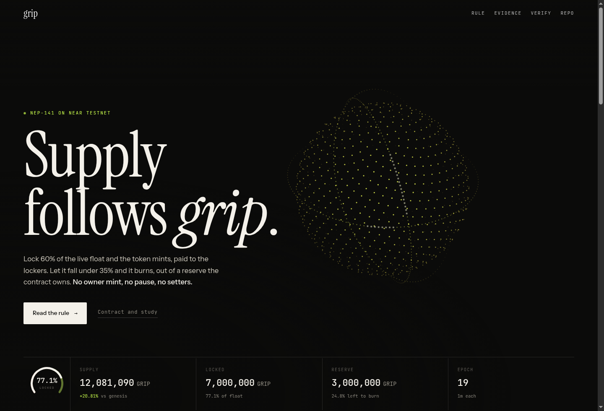
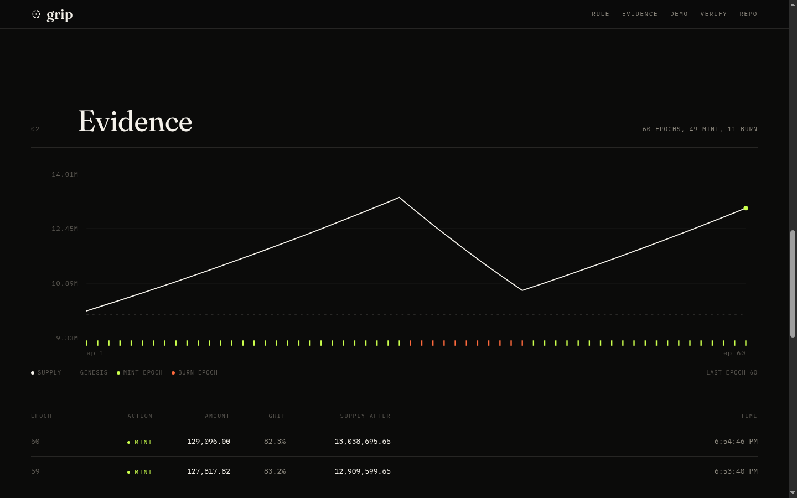

<p align="left"></p>

# GRIP, a token whose supply follows grip

**The problem.** Every memecoin has the same supply curve: the developer decides how much exists, and
nothing the community does changes it. The meme is decoration on top of a fixed number.

**What GRIP does.** Supply is a function of one measurable, verifiable thing: how much of the coin's
live float its holders have locked. Lock up as a community and the token mints, paying the people who
stayed. Fold, and it burns out of a fixed reserve. The deployer has no mint, no pause, and no setter.
after deployment the only actor that decides supply is the community.

Live on NEAR testnet: **[`grip599cb0.grip-21a10e2e.testnet`](https://testnet.nearblocks.io/address/grip599cb0.grip-21a10e2e.testnet)** (mirror: [near.rocks](https://near.rocks/address/grip599cb0.grip-21a10e2e.testnet)) ·
dashboard: **[farhanqaz.github.io/grip-memecoin](https://farhanqaz.github.io/grip-memecoin/)** (source: [`docs/index.html`](docs/index.html)) ·
one command check: **`./scripts/verify.sh`** · judge sheet: [`SUBMISSION.md`](SUBMISSION.md)





## The mechanic

```text
engaged      = total_supply - reserve
locked_share = total_locked / engaged

locked_share >= 60%  ->  mint 1% of supply, pro-rata to whoever is locked
                          (locks release at their own deadline, so grip has to be maintained)
locked_share <= 35%  ->  burn 2% of supply, out of the reserve only
supply is capped at 4x genesis, so the mint cannot compound forever
otherwise            ->  nothing
```

The reserve is 30% of genesis, held by the contract and spendable by nothing but the burn rule. Grip is
measured against live float (`supply - reserve`) rather than raw supply, because counting 30% of
unownable supply as float would cap grip at 70% forever and the community could never move the metric it
is supposed to control.

The burn is twice the mint on purpose: a grip epoch should pay out, a fold epoch should cost. The
asymmetry is what makes supply contract under churn instead of creeping up forever.

## Try it

Four commands, no wallet, no keys needed for the first two.

```sh
# 1. the contract's twelve unit tests  (~1s, no network)
cd contract && cargo test

# 2. the supply study the parameters came from  (~1s, pure Python, no dependencies)
cd ../sim && python3 sim.py

# 3. every claim in this README, including a read of the live contract  (~10s, needs curl)
cd .. && ./scripts/verify.sh
```

Step 3 is the one a reviewer should run: it re-runs the tests, rebuilds the wasm, re-runs the study, and
then asks the deployed contract for `get_state`, so the numbers on this page are checked against the chain
rather than taken on trust.

```sh
# 4. optional: deploy a fresh instance and run three scripted actors against it
cd demo && npm install && npm run demo

# 5. open the dashboard (it reads whatever contract you point it at)
cd ../docs && python3 -m http.server 8765
#   http://localhost:8765/index.html?contract=<account id from step 4>
#   or the hosted copy: https://farhanqaz.github.io/grip-memecoin/
```

Step 4 needs a funded testnet account. It mints a throwaway one through the public testnet helper, which
rate-limits by IP: if it answers 429, either wait, or pass your own account with
`STATE_FILE=./my-account.json node deploy.mjs` (same JSON shape, key and account id), or skip step 4
entirely, since step 3 already proves the deployed contract works.

Step 3 is the whole story in one run: genesis, two people locking past the 60% target, an epoch rolling
and minting to the lockers, then one actor exiting early and burning 10% of their own lock.

The public deployment is driven by two small scripts so the dashboard is not a dead chart: seed.mjs has
the deployer lock its float as a stand-in community, and keeper.mjs calls the permissionless `tick()`
when an epoch is due. Neither has any power the rule does not already give anyone.

```sh
cd demo
EPOCH_NS=60000000000 node deploy.mjs      # a public instance with 60s epochs
LOCK_EPOCHS=30 node seed.mjs             # stand-in community locks for 30 epochs
node keeper.mjs                          # ticks each due epoch; --once fits in cron

# the keeper can drive any deployment: tick() is permissionless, the key only pays for gas
CONTRACT=grip599cb0.grip-21a10e2e.testnet node keeper.mjs
```

If `deploy.mjs` answers `429 Rate limit exceeded`, the public testnet account helper is rate-limiting your
IP (it allows a handful of throwaway accounts per day). Create a testnet account in a wallet, then run
`STATE_FILE=./my-account.json node deploy.mjs` with that key in the same shape, or reuse an existing
instance with `node run.mjs` after pointing `demo-account.json` at it.

## What is in here

| Path | What it is | How to check it |
| --- | --- | --- |
| [`contract/`](contract) | the NEP-141 token and its epoch rule (Rust, `near-sdk` 5) | `cargo test`, 12 tests |
| [`sim/`](sim) | 60-epoch supply study; the parameters were picked from a 108-combination sweep | `python3 sim/sim.py` |
| [`demo/`](demo) | testnet deploy, three scripted actors, and the keeper | `cd demo && npm run demo` |
| [`docs/`](docs) | static dashboard, served by GitHub Pages; one HTML file, no build step, no SDK | open it |
| [`tools/`](tools) | RPC proxy, and the recorder + renderer that produced the demo video | `python3 tools/rec.py` |

The study behind the numbers (60 epochs, 200 holders, fixed seeds, fully reproducible):

```
scenario    supply  mint  burn  skip
grip         1.75x    58     1     0
churn        1.17x    20     2     0
fold         0.86x    15    15     4
```

Grip means the community holds 60%+ locked for the whole window: supply ends 75% higher and every token
of it goes to lockers. Fold means it decays: the reserve is spent down and supply ends 14% lower.

## The demo run

The recorded run is [`demo/demo.mp4`](demo/demo.mp4) (85s). It is rebuilt, not acted out, in three layers:
`tools/rec.py` records the child process's own output with timestamps into `demo/demo.cast`,
`tools/cast2mp4.py` replays those timings into a video, and `tools/film.py` cuts that together with stills
of the live dashboard and two cards, retiming the terminal with a beat map so each beat lands under the
sentence that describes it. Frame order and timing are whatever the run produced; the editing only decides
what you look at. The voice is synthesised one sentence at a time so the subtitles are sample-accurate.

## Verify the deployment

Any of these return the same numbers the dashboard shows, straight from the contract:

```sh
curl -s https://rpc.testnet.fastnear.com -X POST -H 'Content-Type: application/json' \
  -d '{"jsonrpc":"2.0","id":"1","method":"query","params":{"request_type":"call_function",
       "finality":"final","account_id":"grip599cb0.grip-21a10e2e.testnet",
       "method_name":"get_state","args_base64":"e30="}}'
```

`get_state` returns supply, reserve, engaged, locked share, every fixed parameter, and the last 90 epoch
records (`epoch`, `action`, `share_bps`, `supply`, `timestamp`). The dashboard's chart is a direct
reading of that array, not a separate index.

## Design notes worth arguing about

- **Grip decays unless it is renewed.** A lock releases itself when its deadline passes, and that
  happens *before* the epoch rule is evaluated. So a passive holder cannot freeze the metric above the
  target forever: stop renewing and the next epoch reads a lower grip, then burns.
- **The rule is permissionless, not autonomous.** `tick()` can be called by anyone and cannot be
  blocked. If nobody calls it, no epoch is evaluated; the next call rolls up to 12 elapsed epochs and
  applies the rule to each, so nothing is lost. A keeper is a 20-line script, deliberately kept
  off-chain so the mechanic has no privileged actor in it.
- **Mints are pro-rata via an accumulator, not a loop.** `acc` is a reward-per-locked-unit scaled by
  1e12, so a mint is O(1) no matter how many lockers exist.
- **The burn budget is finite by construction.** Once the 30% reserve is spent, a fold epoch records
  `hold` instead of burning. That is a design ceiling, not a bug, and a test pins it.
- **Everything is fixed at deployment.** No setters, no upgrade path, no `#[private]` methods. The
  contract's whole power is the rule above.

Known limits (the ones a judge should hold us to) are listed in
[`contract/README.md`](contract/README.md#known-limits-stated-plainly): no sybil resistance, a finite
burn budget, no AMM (the track says the price chart does not count), and the accumulator's 1e-12
rounding dust.

## Deployed parameters

| Parameter | Value |
| --- | --- |
| genesis | 10,000,000 GRIP |
| reserve | 30% (3,000,000, contract-owned) |
| lock target / burn target | 60% / 35% |
| mint / burn per epoch | 1% / 2% |
| early-exit burn | 10% of the lock |
| epoch length | 1 day in production; the testnet demo uses 10s so an epoch turns over on camera |

## Built for NEAR HACKATHON

Track: `memecoins` (with `social`). Built 1 to 14 Nov 2026.

## License

MIT, see [LICENSE](LICENSE).
